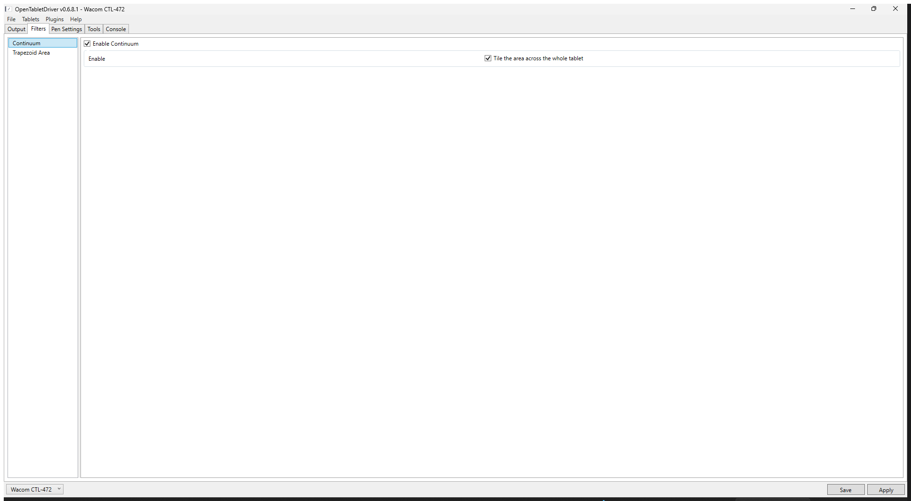

# Continuum

An [OpenTabletDriver](https://opentabletdriver.net/) filter that makes your tablet area **repeat across the whole tablet**.
Move the pen off one edge of the area and the cursor appears on the opposite edge — like an infinite canvas / wrap-around scrolling — and the rest of the tablet is filled with copies of the same area.



```
  tablet surface
  ┌───────────┬───────────┬───────────┐
  │   copy    │   copy    │   copy    │
  ├───────────┼───────────┼───────────┤
  │   copy    │  ▣ AREA   │   copy    │   every tile maps to the
  ├───────────┼───────────┼───────────┤   same rectangle on screen
  │   copy    │   copy    │   copy    │
  └───────────┴───────────┴───────────┘
```

## Features

* Tiles the configured tablet area over the entire tablet surface.
* Crossing any edge wraps the cursor to the opposite side (torus behaviour, both axes).
* Works with rotated areas and with areas that are not centred on the tablet.
* Reads the area **live** from OpenTabletDriver, so changing the area and pressing *Apply* is enough — no restart, no toggling the filter.
* Single self-contained DLL, no extra dependencies.

## How it works

Continuum is an `IPositionedPipelineElement<IDeviceReport>` running at `PipelinePosition.PreTransform`,
i.e. on raw digitizer coordinates before OpenTabletDriver applies the tablet area.

For every report it:

1. converts the raw position to millimetres,
2. moves it into the area's local frame (centre + rotation),
3. applies a positive modulo by the area's width/height,
4. moves the result back to raw coordinates.

Because the output always lands inside the area, the normal absolute mapping shows exactly one copy on screen,
and the physical area outside the chosen rectangle simply becomes the next tile.

## Installation

1. Download `Continuum.zip` from the [Releases](../../releases) page.
2. Do one of the following:
   * drag & drop the zip onto the OpenTabletDriver **Plugin Manager**, or
   * unpack it into `%LOCALAPPDATA%\OpenTabletDriver\Plugins\Continuum\`
     (`Continuum.dll` + `metadata.json`).
3. Restart OpenTabletDriver.
4. Open the **Filters** tab, add **Continuum** and tick it.

## Usage

* `Enable Continuum` — the usual per-filter switch in the profile.
* `Enable` / **Tile the area across the whole tablet** — the wrap mode itself.
* There are no numbers to configure: the plugin uses the tablet area from **Output → Tablet**.
  Move or resize the area, press *Apply*, and the tiling follows immediately.

## Notes and limitations

* Absolute mode only (`Absolute Mode`); relative mode has no meaningful "area" to wrap.
* Do not stack it with area-shaping filters (e.g. *Trapezoid Area*): those already pin the cursor inside
  the area, so there is nothing left to wrap.
* The area is taken from the running driver; `settings.json` is used only as a fallback
  (for example when the plugin cannot reach the driver objects).
* If the area cannot be resolved at all, the filter disables itself and writes an error to the
  **Console** tab instead of breaking the tablet.

## Building from source

Requires the **.NET 10 SDK** (OpenTabletDriver 0.6.8.x targets `net10.0`).

```powershell
dotnet build src/Continuum/Continuum.csproj -c Release
dotnet run  --project tests/Continuum.Tests/Continuum.Tests.csproj -c Release
```

or simply:

```powershell
powershell -ExecutionPolicy Bypass -File .\build.ps1
```

`build.ps1` compiles the plugin, runs the test harness and copies the result to `dist/`.

## Project layout

```
src/Continuum/
  ContinuumFilter.cs   the filter (settings, pipeline element, wrap maths)
  AreaResolver.cs      resolves the area from the live driver, falls back to settings.json
  OtdAreaSource.cs     reads the tablet area from OpenTabletDriver's settings.json
tests/Continuum.Tests/ 26 self-checks (wrap, tiling, rotation, boundaries, live area)
dist/                  ready-to-copy build
```

## Русский

Плагин заставляет выделенную область планшета «размножаться» по всей его поверхности:
выводишь перо за край — курсор появляется с противоположной стороны (как бесконечный холст).
Ничего настраивать не нужно, используется область из `Output → Tablet`;
после изменения области достаточно нажать *Apply*.

## Credits

* Owner / maintainer: **KeyZenD**
* Created with **deepseek** (DeepSeek Harness)

## License

MIT — see [LICENSE](LICENSE).
